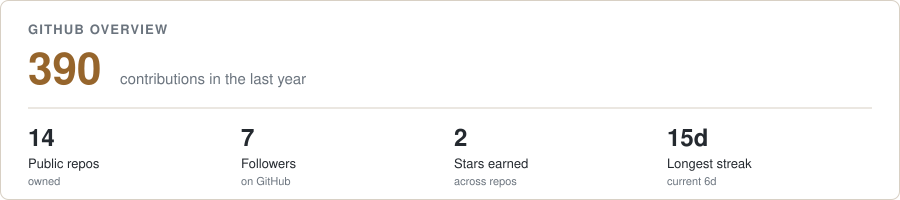
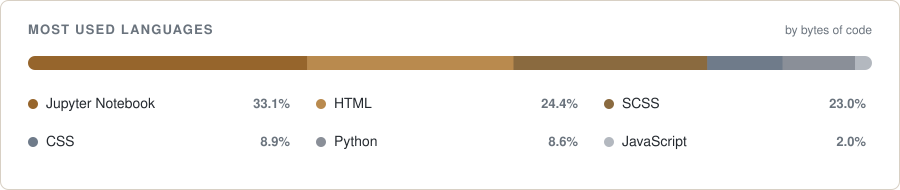
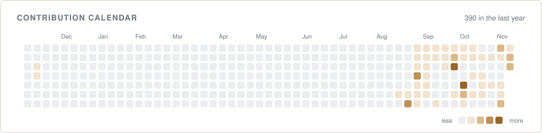

 

---

## 👋 About

I have lectured in the **Artificial Intelligence program at BINUS University, Jakarta** since 2025. My teaching covers machine learning, computer vision, and research methodology, and most of what lives in this account exists because a class needed it: a competition platform, quiz portals, a teaching tool that makes backpropagation visible.

> **Proof over claims.** The systems below are running, and the ones students touch carry real teaching load every week.

| | |
| :-- | :-- |
| 🎓 **Role** | AI lecturer, BINUS University (Jakarta, Indonesia) |
| 🔬 **Research** | Computer vision, deepfake detection, LLM behaviour in medical settings |
| 🧱 **Builds** | Self-hosted teaching infrastructure on small, ownable stacks |
| 🌐 **Languages** | English · Bahasa Indonesia ([site mirrored in ID](https://asaeltarigan.github.io/id/)) |

---

## 🚀 What I run

| System | What it is | Stack |
| :-- | :-- | :-- |
| **[arise-competition-platform](https://github.com/asaeltarigan/arise-competition-platform)** | ARISE, a Kaggle-style ML competition platform for a national Indonesian high-school competition. Three scored tracks, self-hosted on a single small VPS. | `FastAPI` `SQLite` `Python` |
| **[asaeltarigan.github.io](https://github.com/asaeltarigan/asaeltarigan.github.io)** | My academic site, with a hand-written design system, mirrored in Indonesian. | `Jekyll` `HTML` `CSS` |
| **[skeletal-keypoint-engagement](https://github.com/asaeltarigan/skeletal-keypoint-engagement)** | Code for my master's thesis: recognising student engagement from skeletal keypoints in classroom video. | `PyTorch` `Python` `Jupyter` |
| **[build-diary](https://github.com/asaeltarigan/build-diary)** | An automated public log. A script commits what I actually shipped that week, and stays silent when nothing changed. | `Python` `Git` |

---

## 📚 Selected research

- 🛡️ **Enhancing Cross-Dataset Generalization in Deepfake Detection** · accepted at **IEEE ISRITI 2026**
- 🩺 **Emotional Framing Effects on Medical Triage in General-Purpose and Medical-Adapted LLMs** · accepted at **IEEE ICICyTA 2026**

Abstracts live on my [publications page](https://asaeltarigan.github.io/publications/).

---

## 🛠️ Tech stack

**Core**

**Web & Tooling**

| Area | What I reach for |
| :-- | :-- |
| **Machine learning** | PyTorch, Jupyter, classical ML, computer vision |
| **Backend** | FastAPI, SQLite, plain files |
| **Infra** | Linux, one small VPS, GitHub Pages |
| **Teaching** | Live notebooks, competitions, interactive visualisations |

---

## 📊 GitHub stats

<picture>
  <source media="(prefers-color-scheme: dark)" srcset="./metrics/overview-dark.svg" />
  
</picture>

<picture>
  <source media="(prefers-color-scheme: dark)" srcset="./metrics/languages-dark.svg" />
  
</picture>

 

<picture>
  <source media="(prefers-color-scheme: dark)" srcset="./metrics/calendar-dark.svg" />
  
</picture>

---

## 🧭 How I work

- **Build the thing, then teach it.** Students trust a system they can use, not a slide about one.
- **Label work honestly.** Student capstones stay labelled as student work, and "accepted" means accepted.
- **Keep it small enough to own.** One VPS, plain files, no dependency I cannot explain.

---

**Teaching AI in Jakarta · Writing about it [on Medium](https://medium.com/@asaeltarigan) · Building it in public here**

